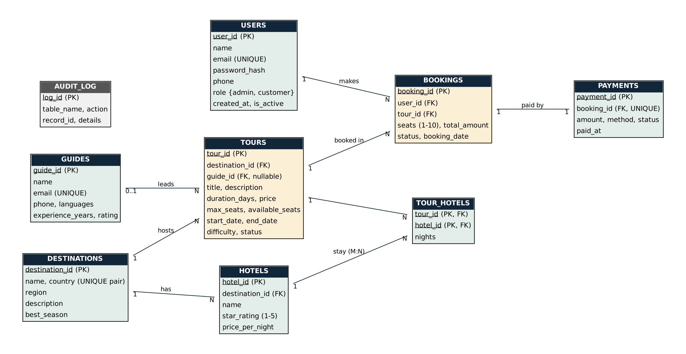

# Wanderly: Travel & Tour Management System
**DBMS Experiential Learning, Level 3 Project** · Department of Computer Science and Engineering, PES University
Team: K SRUJANA,PES1UG24AM128 
      KP PREETIKA SETTY,PES1UG24AM144
Section:C 

## 1. Objectives
* Replace spreadsheet/phone based tour booking with a consistent, multi-user system.
* Prevent overbooking and keep seat counts, payments and refunds correct even when many people book at once.
* Give customers search, booking, cancellation and reviews; give admins operational control and analytics.
* Demonstrate sound relational design plus a justified second database paradigm (document store).

**Problem addressed.** Small tour operators lose money to double bookings and manual refunds, and have no feedback loop. The system enforces seat availability and payment consistency inside the database, and stores free-form content (itineraries, reviews) in a document database where a rigid schema would be awkward.

## 2. Functional Requirements
| # | Requirement | Role |
|---|-------------|------|
| F1 | Register, log in, log out (JWT in httpOnly cookie, bcrypt hashed passwords) | All |
| F2 | Search tours (full-text), filter by destination, difficulty and price, sort | Public |
| F3 | View tour detail: hotels, guide, day-by-day itinerary, reviews | Public |
| F4 | Book 1-10 seats and pay (UPI/card/net banking/cash) | Customer |
| F5 | View own bookings; cancel with automatic refund and seat release | Customer |
| F6 | Review a tour only after booking it; one review per tour | Customer |
| F7 | Create / edit / delete tours; add destinations | Admin |
| F8 | View all bookings; mark bookings completed; cancel any booking | Admin |
| F9 | Dashboard: revenue by destination, best sellers, fill rates, audit log, review analytics | Admin |

Roles: **admin** and **customer** (role-based access enforced in the API layer; public sign-up can only create customers).

## 3. Database Choice and Justification
| Data | Database | Why |
|------|----------|-----|
| Users, destinations, guides, hotels, tours, bookings, payments, audit log | **MySQL** | Strongly structured, relational, needs ACID transactions, foreign keys, CHECK constraints, triggers and joins. Money and seat counts must never be inconsistent. |
| Itineraries (nested days, activities, meals, inclusions) | **MongoDB** | Variable-length nested data read as one unit with the tour page; no joins needed; a 5 table relational model would add complexity without benefit. |
| Reviews (rating, free text, tags) | **MongoDB** | Write-heavy, flexible tags, text search, and aggregation pipelines for averages and distributions. |
| Activity logs (views, searches) | **MongoDB** | Append-only event data with a TTL index (auto-expiry after 90 days). |

A vector database was considered (semantic search over reviews) and left out because the data volume does not justify it. It can be added later (e.g. pgvector or Qdrant) without changing the SQL design.

## 4. ER Diagram
See `docs/er_diagram.png` (source: `er_diagram.dot`).



Relationships: Destination 1:N Tour · Destination 1:N Hotel · Guide 1:N Tour (optional) · User 1:N Booking · Tour 1:N Booking · Booking 1:1 Payment · Tour M:N Hotel (via `tour_hotels`).

## 5. Relational Schema
```
users(user_id PK, name, email UNIQUE, password_hash, phone, role, created_at, is_active)
destinations(destination_id PK, name, country, region, description, best_season; UNIQUE(name,country))
guides(guide_id PK, name, email UNIQUE, phone, languages, experience_years, rating)
hotels(hotel_id PK, destination_id FK->destinations, name, star_rating, price_per_night)
tours(tour_id PK, title, description, destination_id FK->destinations, guide_id FK->guides NULL,
      duration_days, price, max_seats, available_seats, start_date, end_date, difficulty, status, cover_emoji)
tour_hotels(tour_id FK->tours, hotel_id FK->hotels, nights; PK(tour_id, hotel_id))
bookings(booking_id PK, user_id FK->users, tour_id FK->tours, seats, total_amount, status, booking_date)
payments(payment_id PK, booking_id FK->bookings UNIQUE, amount, method, status, paid_at)
audit_log(log_id PK, table_name, action, record_id, details, created_at)
```
**Normalisation:** all tables are in 3NF. The M:N tour-hotel link is resolved with a junction table; `total_amount` on bookings is an intentional snapshot of price at booking time (price may change later).

## 6. Data Dictionary (key columns and constraints)
| Table.column | Type | Constraint |
|---|---|---|
| users.email | VARCHAR(150) | UNIQUE, NOT NULL, CHECK email pattern |
| users.phone | VARCHAR(15) | CHECK `^[0-9+ -]{7,15}$` |
| users.role | ENUM(admin, customer) | NOT NULL, default customer |
| tours.price | DECIMAL(10,2) | CHECK >= 0 |
| tours.available_seats | SMALLINT | CHECK 0 <= available <= max_seats |
| tours.end_date | DATE | CHECK end_date >= start_date |
| tours.status | ENUM(open, closed, cancelled) | NOT NULL |
| hotels.star_rating | TINYINT | CHECK BETWEEN 1 AND 5 |
| bookings.seats | SMALLINT | CHECK BETWEEN 1 AND 10 |
| bookings.status | ENUM(confirmed, cancelled, completed) | NOT NULL |
| payments.booking_id | INT | UNIQUE FK (one payment per booking) |
| payments.method | ENUM(card, upi, netbanking, cash) | NOT NULL |

Foreign-key actions: deleting a destination is RESTRICTED while tours exist; deleting a guide sets `tours.guide_id` to NULL; deleting a tour cascades to `tour_hotels`; deleting a user cascades to bookings.

## 7. Database Implementation
### 7.1 SQL (files in `database/`)
* **DDL:** CREATE (9 tables), ALTER (4 statements adding columns and a CHECK), DROP (scratch table), primary/foreign keys, CHECK/UNIQUE/NOT NULL constraints.
* **Indexes:** composite `(destination_id, start_date)`, `price`, `(user_id, booking_date)`, `(tour_id, status)`, and two FULLTEXT indexes.
* **Views:** `v_tour_catalog`, `v_booking_details`, `v_revenue_by_destination`.
* **Advanced concepts (SQL):**
  1. **Transactions** - `sp_book_tour` and `sp_cancel_booking` use START TRANSACTION / COMMIT with an EXIT HANDLER that rolls back; `SELECT ... FOR UPDATE` locks the tour row to prevent overbooking.
  2. **Stored procedures and function** - `sp_book_tour`, `sp_cancel_booking`, `fn_tour_revenue`.
  3. **Triggers** - seat validation (BEFORE INSERT), seat decrement + auto-close + audit (AFTER INSERT), seat restore + refund + audit (AFTER UPDATE), delete protection (BEFORE DELETE).
  4. **Views, indexing and full-text search** as above.
* **DML:** INSERT (register, book, create tour), UPDATE (edit tour, complete booking), DELETE (delete tour), SELECT with JOIN, GROUP BY, HAVING, ORDER BY, aggregates and sub-queries (`database/04_important_queries.sql`).

### 7.2 MongoDB (`mongodb/schema_and_queries.js`)
* **Data model:** `itineraries` (one doc per tour), `reviews`, `activity_logs`. Documents reference SQL rows by `tourId` / `userId` (application-level link).
* **Validation:** `$jsonSchema` validator on `reviews` (rating 1-5, comment length).
* **Indexes:** `reviews(tourId, createdAt)`, unique `reviews(tourId, userId)`, text index on review title/comment, unique `itineraries(tourId)`, TTL on `activity_logs.ts`.
* **Aggregations (NoSQL advanced concept):** average rating per tour, rating distribution, most-used tags (`$unwind`), most viewed tours.
* **Embeddings / vector search:** not used (see section 3).
* **Retrieval strategy:** tour page loads SQL row (hotels, guide) and the itinerary document in two lookups; reviews are fetched sorted by newest and aggregated for the summary.

## 8. Important Queries
See `database/04_important_queries.sql` (Q1-Q11) and the API handlers in `app/api/`. Highlights: full-text search with relevance score, revenue per destination via view, HAVING filter on customer spend, subquery for above-average prices, transaction demo with trigger side effects, and `EXPLAIN` showing index use.

## 9. System Architecture
```
Browser (Next.js pages, React)
   | fetch JSON (httpOnly JWT cookie)
Next.js Route Handlers  /api/*   <- authentication, role guard, validation
   |-- mysql2 pool  ---> MySQL  (tours, bookings, payments, ...; procedures, triggers)
   |-- mongodb driver -> MongoDB (itineraries, reviews, activity_logs)
```
Credentials come only from environment variables (`.env.local`, git-ignored). Passwords are stored as bcrypt hashes; tokens are signed JWTs (HS256, 7 days). Authorisation is checked on the server for every protected route, not just in the UI.

**Data validation and integrity** is layered: HTML5 input constraints in the UI, explicit checks in route handlers, and, authoritatively, CHECK / UNIQUE / FK constraints, triggers and transactions in MySQL, plus the JSON-schema validator in MongoDB.

## 10. Application Screenshots
Insert screenshots here after running the app: home with filters, tour detail with itinerary and booking panel, my bookings, admin overview, admin tours, login/register.

## 11. Testing Results
Test cases are in `docs/TEST_CASES.md` (24 cases covering authentication, RBAC, search, booking, rollback, triggers, constraints, NoSQL rules and concurrency). Add the pass/fail result and a screenshot per test.

## 12. Conclusion
The system goes beyond CRUD by pushing business rules into the database (transactions, triggers, constraints), using a document database where the data is naturally nested and read-heavy, and delivering both through a role-based Next.js application. Possible extensions: payment gateway, semantic search over reviews using a vector index, seat-level selection, and email notifications.

## 13. Team Responsibilities (edit to match your commits)
| Area | Member 1 | Member 2 |
|---|---|---|
| Database | ER diagram, MySQL schema, constraints, indexes | Triggers, procedures, transactions, views, MongoDB model |
| Backend | Auth, tours, destinations APIs | Bookings, reviews, admin stats APIs |
| Frontend | Home, tour detail, auth pages | Bookings and admin dashboard pages |
| Docs/Testing | Documentation, ER diagram | Test cases, demo script |
Both members commit to their own branches (`git log --author`) so contributions are visible.

## 14. Demo Script (suggested order, matches the evaluation list)
ER diagram and schema -> run SQL files -> show triggers/procedures -> important queries -> Next.js UI (search, book, cancel) -> show seats/audit changing in MySQL -> MongoDB reviews and aggregation -> RBAC (customer blocked from admin) -> test cases -> individual contributions.
